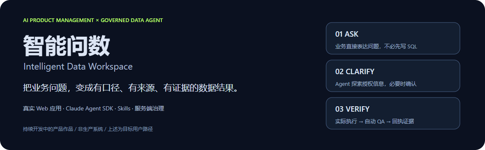
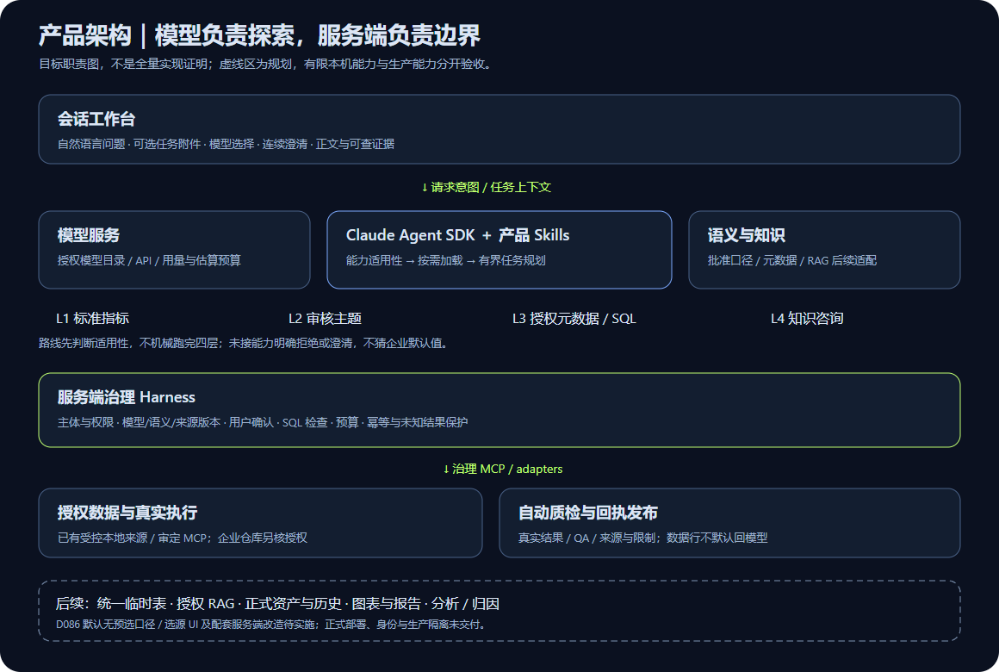
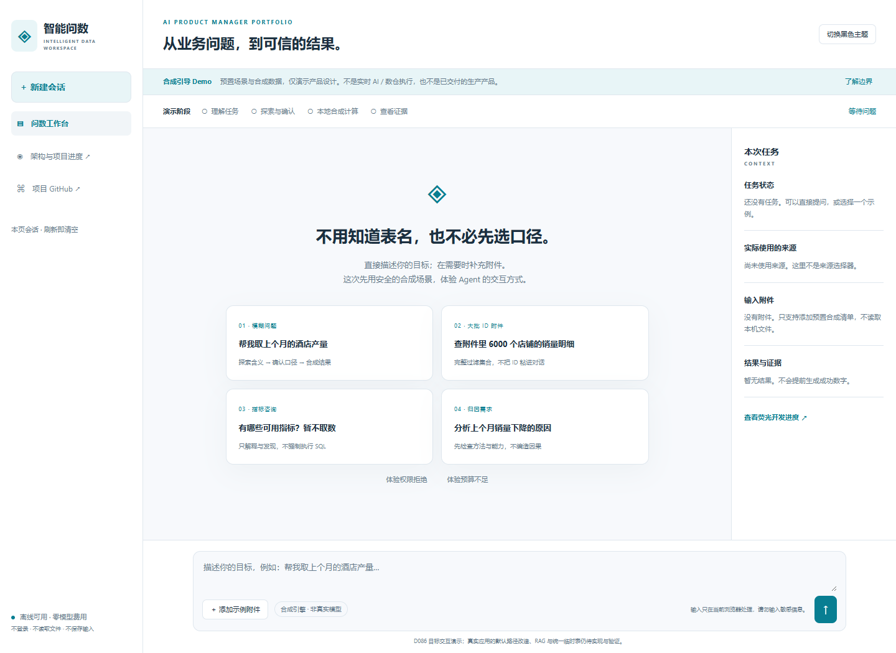
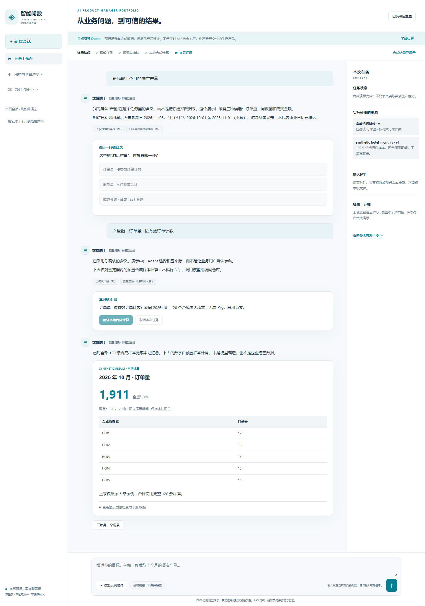
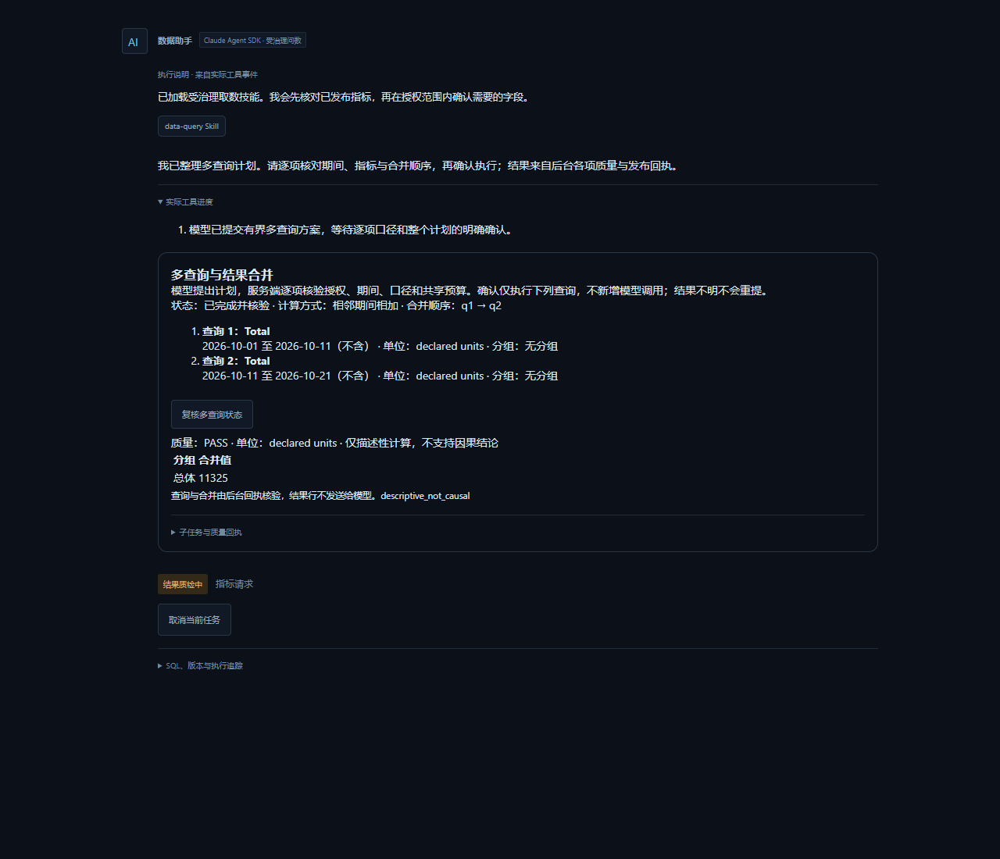
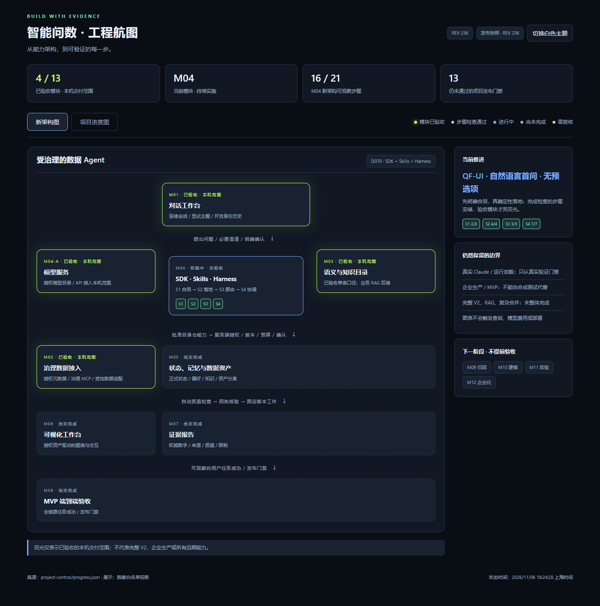
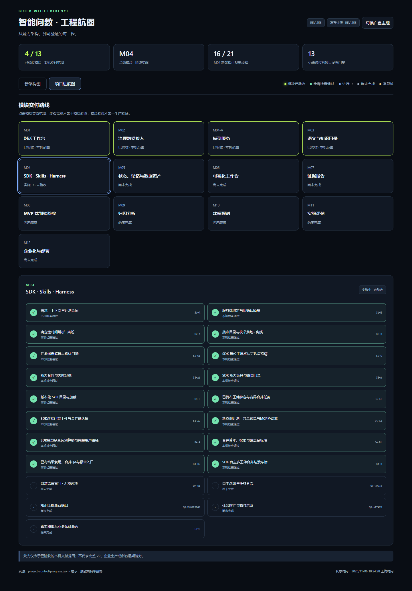

<p align="center"><strong>智能问数 · Intelligent Data Workspace</strong></p>
<h3 align="center">让业务直接提问，让 Agent 查清口径，让结果带着证据。</h3>

<p align="center">
  <a href="#产品预览"><strong>▶ 看产品预览</strong></a> &nbsp;·&nbsp;
  <a href="#产品架构"><strong>查看架构</strong></a> &nbsp;·&nbsp;
  <a href="#开发进度"><strong>荧光进度图</strong></a> &nbsp;·&nbsp;
  <a href="docs/DEMO_OPTIONS.md"><strong>在线 Demo 方案</strong></a>
</p>



> **这是一个以真实 Web 应用交付的 AI 产品经理作品，正在持续开发。** 静态合成 Demo 已制作，公开地址正在发布验证；下面提供界面预览与可下载的交互进度图，不需要配置模型 Key。真实产品目前在本机运行，不能把本机链接当作面试官可访问的网站。

## 为什么做这个产品

业务用户常常知道自己要解决什么问题，却不知道“指标如何定义、数据在哪张表、应该找谁取数”。传统报表适合固定问题，长尾问题仍可能经历反复解释、口径核对、写 SQL 和结果复核。

**智能问数希望把这个过程收进一个连续会话。** 用户直接表达目标，Agent 在授权范围内探索语义、知识和元数据，在关键歧义处确认，再选择数据来源并执行；结果不仅有数字，还能说明采用了什么口径、来自哪里、检查了什么、有哪些限制。

这是产品假设与设计目标，不是已经验证的客户收益或用户研究结论。

| 谁在使用 | 要完成的任务 | 产品如何分工 |
| --- | --- | --- |
| 业务用户 | 提问、补充附件、确认关键含义、查看结果 | 不要求预知指标 ID、表名或先选数据源 |
| 分析师 | 核对口径、质量、SQL 与数据证据 | 技术细节按需展开，不占据业务默认路径 |
| 管理员 | 配置连接、模型、权限与批准口径 | 管理入口与业务问答分开，授权由服务端执行 |

## 产品架构



**模型负责探索与规划，Skills 提供能力知识，Harness 守住执行边界。**

- **L1–L4 按适用性路由**：标准指标 → 已审核主题能力 → 授权元数据与受控查询；知识咨询独立适配。不是每次都机械跑完四层。
- **服务端治理 MCP / adapters**：取数要经过授权、版本、确认、SQL 与预算检查；Prompt 或 Skill 不等于执行权限。
- **真实结果先质检、后发布**：用执行与质量回执约束数字输出；失败、空结果与未知状态必须清楚说明，未知执行不自动重提。
- **任务附件与知识分别治理**：附件可能是过滤集合，知识用于支持口径理解；统一临时表、完整 RAG 与正式资产生命周期仍有后续实施范围。

主线采用 **Claude Agent SDK + 产品 Skills + 服务端治理 Harness**。前端为 React / TypeScript / Vite，后端为 FastAPI / Pydantic；OpenAPI 生成前端合同，受控本地执行使用 DuckDB / MCP 与隔离 Worker。

<details>
<summary>设计决策与当前边界</summary>

- 不把所有问题强制转成取数：咨询、分析与归因要先检查目标和能力，未实现的能力不冒充成功。
- D086 已明确取消默认口径下拉和右栏来源勾选；Agent 探索、澄清后自主选源，右栏只展示实际来源与附件。这一默认路径改造**尚待实施**。
- 现有单表口径、有限 SDK 路由与本机执行，不等于完整企业语义、自由 SQL、跨源 JOIN 或业务 RAG。
- Windows 隔离与本机开发身份已有对应测试范围；正式身份、跨租户、生产部署和官方 Claude 最新真实集成仍需补验。

[通用架构设计](project-control/ARCHITECTURE_V2.md) · [M04 产品 PRD](project-control/prd/M04-B.md) · [自然语言优先与附件规划](project-control/modules/M04/QUESTION_FIRST_ATTACHMENTS_PLAN.md)

</details>

## 产品预览

### 免凭证的合成引导 Demo



*独立静态演示，采用预置场景；不连接真实模型或数仓，不读取本机文件。支持口径澄清、6000-ID 示例附件、指标咨询、失败边界和黑白主题。这是 D086 目标交互展示，不表示真实应用默认路径已实施。公开体验链接正在验证。*

<details>
<summary>展开合成 Demo 的确认与结果样式</summary>



</details>

### 连续会话与可核验的结果



*现有本机合成联调的局部截图，展示查询计划、确认及质量证据；不是公开在线服务，也不是 D086 新版界面。截图中的数据来自独立合成测试，不代表企业经营数据；单个界面阶段不等于整个任务或模块验收。*

### 正在落实的默认用户路径

```text
直接描述目标 + 可选附件
          ↓
判断取数 / 咨询 / 分析等任务意图
          ↓
探索授权知识与元数据 → 关键歧义才确认
          ↓
Agent 选择来源与计划 → 必要执行确认
          ↓
受控执行 → 自动质量检查 → 正文 + 结果证据
```

**目标是让业务用户不写 SQL，也不用先选择标准口径或数据表。** 如上传大批实体 ID，附件应成为服务端的完整过滤集合，而不是把所有行粘进模型上下文；这部分统一临时表能力仍在规划中。

## 开发进度

[](docs/portfolio/progress.html)

- **荧光模块**：仅表示该模块已获用户验收的有限本机交付范围，不代表所有远期能力完成。
- **绿色步骤**：实现、检查与证据一致；新需求不能继承旧测试变绿。
- **蓝色 / 未点亮部分**：正在推进或仍待实施、真实验证和验收。

**当前四个底座模块已验收本机范围：工作台、数据接入、模型服务、单表语义。M04 Agent 仍在开发与补验。** 新增自然语言首问、自主选源、知识端口与任务附件四项保持待实现；真实用户反馈中的失败仍待诊断。完整 RAG、正式资产与历史、图表报告、归因分析、生产 / MVP 交付不能由该图推断已完成。

<details>
<summary>展开步骤进度快照</summary>



</details>

[交互进度图 HTML](docs/portfolio/progress.html) · [脱敏状态快照](docs/portfolio/progress-snapshot.json) · [完整路线](project-control/ROADMAP.md)

> GitHub README 支持图片，但不能执行 JavaScript 或嵌入可运行的 iframe。上图是静态预览；HTML 链接在 GitHub 中显示源码，需下载 `progress.html` 后用浏览器打开，或以后通过静态托管提供在线入口。公开图是发布快照，不会实时读取开发者电脑。

## 如何体验

| 方式 | 当前可用性 | 适合谁 |
| --- | --- | --- |
| README 图片与产品设计 | 现在可读；本次改版正在发布 | 面试官快速了解产品与决策 |
| 下载交互进度图 | 本次已生成，浏览器离线可开；尚未托管 | 查看模块、步骤、黑白主题与证据边界 |
| 本机真实 Web 应用 | 开发者本机可运行，需环境与授权配置 | 技术走查与有限真实验证 |
| 免配置在线交互 Demo | 独立合成引导模式已制作，正在发布验证 | 面试官点击链接即体验 |

**推荐发布路线：先做零凭证的合成引导 Demo + 在线进度图，再单独规划有权限与预算保护的真实后端演示。** [查看方案及取舍 →](docs/DEMO_OPTIONS.md)

<details>
<summary>开发者：本机启动、测试与工程文档</summary>

主要验证环境为 Windows、Python 3.12、Node.js 22.12+；依赖、安装、固定版本和合同生成见 [DEVELOPMENT.md](DEVELOPMENT.md)。SDK 与执行隔离有环境约束，不承诺任意平台直接运行。

已有项目环境中，双击 `start-workspace.cmd`，或运行：

```powershell
./services/api/.venv/Scripts/python.exe scripts/dev.py
```

启动器输出地址后，在**同一台电脑**打开 `http://127.0.0.1:5173`。不要将开发身份绑定公网；不要在前端、README 或演示站点放模型 Key。

- [数据源接入](CONNECTORS.md) · [模型服务](MODEL_SERVICE.md) · [合成数仓](WAREHOUSE.md)
- [模块 PRD](project-control/prd/README.md) · [用户体验原则](project-control/PRODUCT_UX_PRINCIPLES.md)
- [更新日志](CHANGELOG.md) · [本机进度](project-control/progress.json) · [交接记录](project-control/HANDOFF.md)

本机进度与 GitHub 发布范围可能不同，当前状态以验证过的本机账本及相应发布快照为准；README 不是测试或验收证明。

</details>

## 数据与展示边界

只展示自编通用内容和独立合成测试。真实公司资料、用户文件、私有路径与凭证不得进入公开素材；数据行不默认回传模型。没有真实结果就不生成成功数字、下载或因果结论。

本项目尚未指定开源许可证，第三方依赖按各自条款使用。本页的“产品介绍 → 架构 → 预览 → 进度”编排参考 [Archify](https://github.com/tt-a1i/archify)，未复用其图片、代码、宣传数据或品牌素材。
