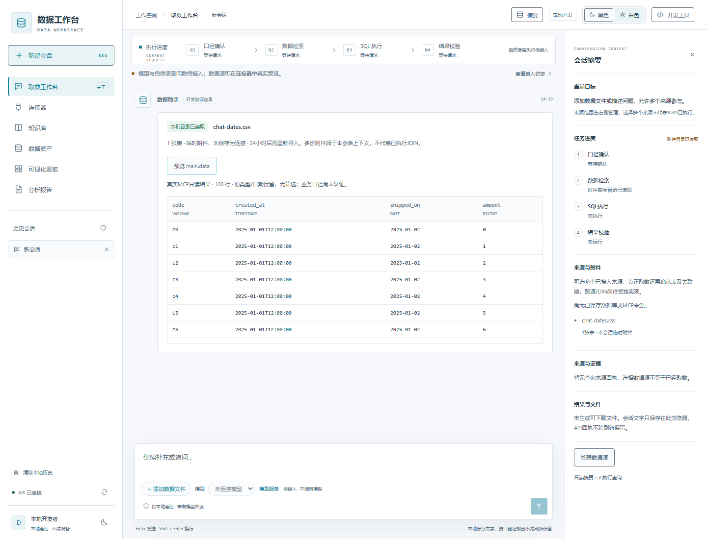
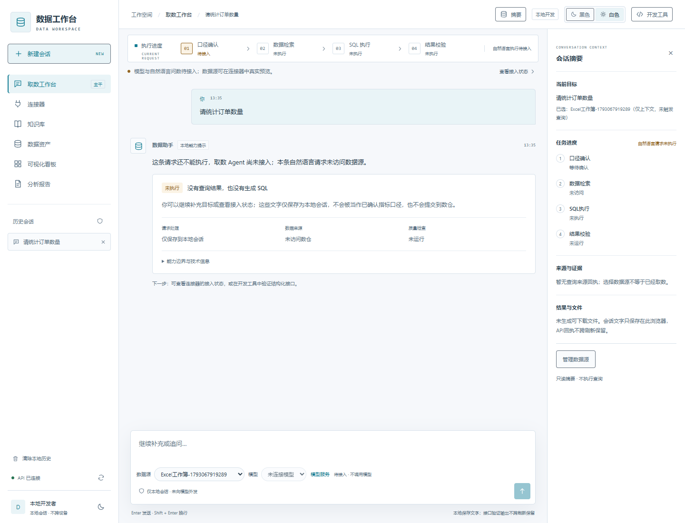
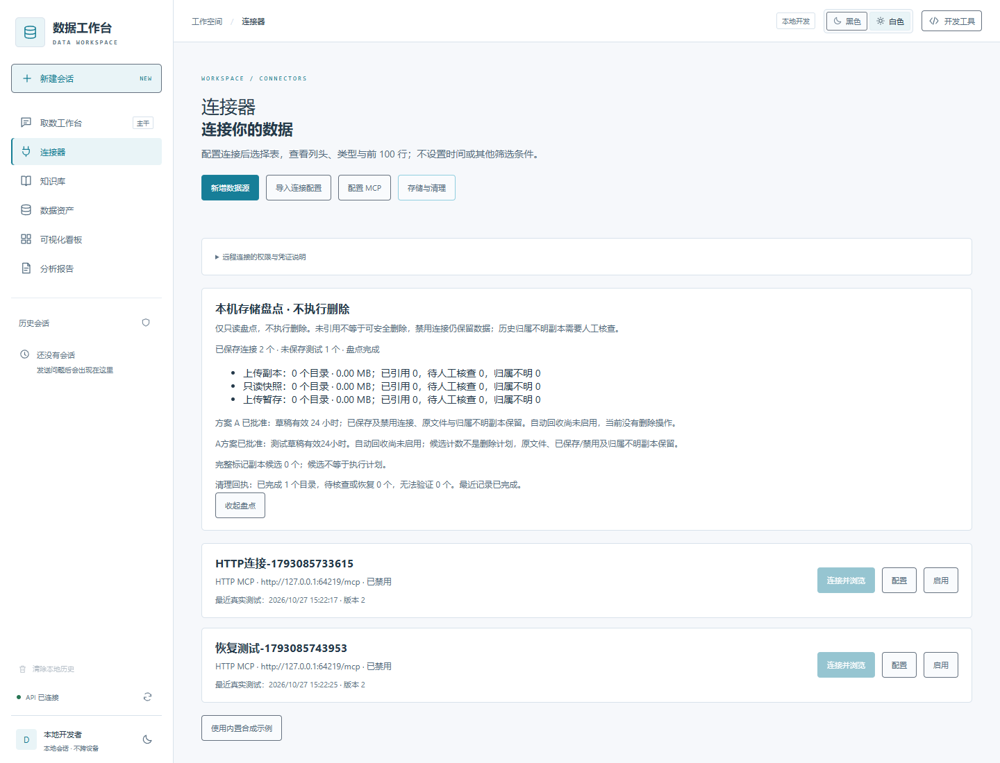
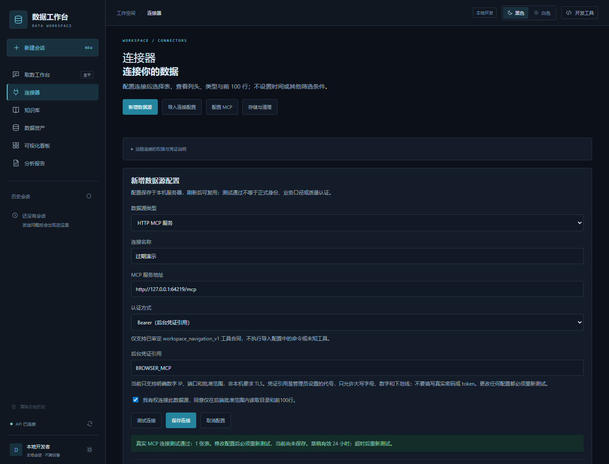
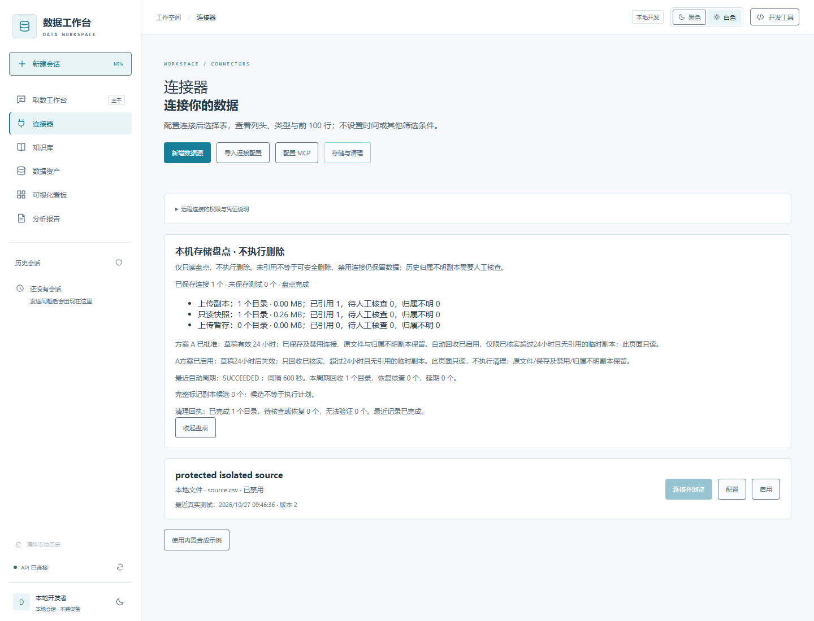

# 通用个人模型 API 接入（2026-10-30）

工作台的“模型服务”新增网页 BYOK 接入：选择OpenAI/DeepSeek/Anthropic预设或自定义标准协议，填写完整API地址、model ID和passwordKey→保存连接（不调用模型）→显式最小测试。公司AIPlan只是可选已授权内网预设。Key仅本次后台memory，提交后字段清空，不进storage/history/log；换Key与清除不重启、不reset估算账本。

支持Responses/OpenAI-compatibleChatCompletions/AnthropicMessages标准文本合同，不保证任意私有API或model别名兼容。自定义公网只允许HTTPS，服务端DNS/IP固定连接/SSRF保护；内部AIPlan路径单独受治理。正式身份/TLS秘密仓库和持久用户模型配置未交付，当前只loopback开发实例，不能当生产多人BYOK认证。

公司AIPlan最小文本已由用户实际验证成功；通用公网厂商与新网页Key路径真实账号集成仍待实际测试。模型目录/流式/SQL/JOIN尚未完成，原主题/历史/附件/多源与真实状态保持。步骤见 [MODEL_SERVICE.md](MODEL_SERVICE.md)，进度证据以project-control/progress.json为准。

# 模型接入首切片（2026-10-28）

M02有限本机已验收，现进入M04-A。模型薄适配和本机隐藏Key启动器已编写：双击 `start-workspace-model.cmd`，Key只在本机后台内存，不在聊天或网页输入、不复制Claude/Codex认证。具体步骤与边界见 [MODEL_SERVICE.md](MODEL_SERVICE.md)。

**真实网关生成仍未验证**，精确协议/model和可核实计价或供应商硬限额需落实；无费用治理时调用拒绝，不将输入Key、文件预览或多源选择冒充模型/SQL/JOIN闭环。PG/生产后补门禁保留。

# 当前交互更新（2026-10-28）

本地文件在聊天输入区直接添加，经安全预检/真实MCP后成为24h临时会话附件，可预览原表头/类型/日期和100行；不自动保存连接、不向模型发送数据行。右侧可纳入多个已授权来源和附件，取消底部单来源选择。连接器仅新建数据库/MCP，旧本地配置与原安全API保留，不删用户数据。多表JOIN和自然语言查询仍待真实实现，多选UI不是JOIN成功。

网关调用及只问题/必要字段外发已获用户确认，PG/生产明确后补；专用Key/有效model协议及15USD可靠计价或供应商限额尚未配置，模型生成仍not_run，不复用宿主Token。最新287后端/16前端/27浏览器通过，界面修复后后端按字节不变复用原fp，详细见项目进度。本輪未push到远端。



---

# 智能问数 · Intelligent Data Workspace

面向业务用户的智能数据分析工作台，也是一个以**真实 Web 应用**交付的 AI 产品经理作品项目。

项目将「提出问题 → 明确口径 → 授权取数 → 查看证据 → 复用结果」作为产品主线，强调用户任务、渐进披露、可行动的失败状态和可核验的测试证据，而非用模拟结果包装尚未接入的能力。

> **当前是持续开发中的本机版本，不是完整智能问数产品或生产系统。** M01 已验收；M02 数据接入正在收尾，尚未验收。自然语言 Agent 和模型 API 尚未接入；真实 PostgreSQL 实例、正式认证与生产部署仍未验证。2026-10-28 本机A保留周期已启用并验证；这不是生产验收。

## 当前可以做什么

- **业务会话工作台**：显式黑色/白色主题、浏览器本地历史、多轮消息、顶部实际状态、结构化结果卡；SQL/Schema 验证放在开发工具中。
- **本地数据接入**：DuckDB、CSV、Parquet、`.xlsx` 文件上传或受控后端路径；真实测试 → 保存 → 刷新复用 → 编辑重测 → 启用/禁用。
- **表导航**：展示原始列头、数据类型和最多前 100 行；**不增加时间或其他筛选，不删除日期列，不猜测业务含义**。
- **受治理 MCP/SQL 底座**：真实 stdio MCP 与只读 DuckDB；HTTP MCP 仅支持受审定的适配合同和后端授权目标，已通过独立本机认证服务验证。
- **安全与恢复**：Windows Job Object 资源限额、固定 Worker 入口、上传安全预检、代际失效、未知结果不自动重提、显式重新连接。
- **保留安全底座**：24 小时测试草稿失效、来源标记、引用保护、原生句柄逐项回收及跨重启幂等恢复、只读清理回执。**本机A自动回收已启用（启动5秒、完成后600秒）；只回收超过24小时、完整归属且无引用的临时副本。原文件、保存/禁用数据与未知历史保留。**

### 能力边界

| 能力 | 当前状态 |
| --- | --- |
| 本机 Web 工作台、主题和开发历史 | 已验收；历史不是正式服务器持久化 |
| 本地文件 / Excel → API → MCP → 只读预览 | 本机真实链路已测 |
| 授权 HTTP MCP 配置、测试、保存和导航 | 独立本机真实服务已测；不代表任意服务兼容 |
| PostgreSQL | 适配器和配置流程已有；真实实例验证 `not_run` |
| 临时副本安全回收 | 本机周期与恢复通过；生产/自然24小时长期驻留仍未认证 |
| 模型 API / 自然语言受控问数 | 规划待实施，不会伪造经营数字或执行成功 |
| 企业登录、跨租户权限、持久任务、生产部署 | 未交付 / `not_run` |

## 2026-10-28 工作台交互更新

左侧历史、中间对话、右侧可收起的任务/来源摘要，输入区新增真实已保存数据源上下文选择及模型入口。**当前模型服务未接入，模型目录为空，不能实际切换或调用模型**；摘要只从已有回执展示状态，选择数据源不会触发SQL。截图只显示本机开发路径，不是企业经营结果。

本项目模型测试预算上限为15USD；供应商协议/专用认证/价格与外发许可需独立核实，不复用宿主工具凭证。前端15单元与26网页检查已过，CSS移动标题修正后10工作台复跑过；后台未改按原证据复用。



## 界面预览

以下为本机开发自测截图，**不是用户研究或真实企业经营数据**。回执截图中的维护计数来自独立测试实例，不代表默认存储状态。





## 技术架构

```text
React + TypeScript + Vite
          │  本机 HTTP / 服务端身份与输入校验
          ▼
FastAPI + Pydantic ── OpenAPI ── 自动生成前端类型
          │
          ├─ 来源配置 / SQLite 非秘密配置与引用
          ├─ 固定 Worker + Windows Job Object
          └─ 受治理 MCP / 只读执行适配
                    ├─ 本地 DuckDB 快照
                    ├─ 审定 HTTP MCP
                    └─ PostgreSQL（待真实实例补验）
```

模型服务与数据源连接分别授权；模型、编排框架和提示词不能代替服务端的权限、SQL、资源及文件网络安全门禁。

## 本机运行

当前主要验证环境为 **Windows + Python 3.12 + Node.js 22.12 以上**。Worker/存储保护使用 Windows 原生机制；不承诺其他平台已验证。需要预先安装 Python、Node.js 和 pnpm，依赖安装会联网，请先审阅锁文件与相关许可。

在项目根目录打开 PowerShell：

```powershell
py -3.12 -m venv services/api/.venv

./services/api/.venv/Scripts/python.exe -m pip install -r services/api/requirements.lock.txt -r services/api/requirements.warehouse.lock.txt -r services/api/requirements.excel.lock.txt
./services/api/.venv/Scripts/python.exe -m pip install --no-deps --no-build-isolation -e services/api
./services/api/.venv/Scripts/python.exe -m pip check

pnpm --dir apps/web install --frozen-lockfile
./services/api/.venv/Scripts/python.exe scripts/dev.py
```

`scripts/dev.py` 在本机开发模式按已批准A默认启用保留周期；停用可先设置 `$env:WORKSPACE_RETENTION_CLEANUP='0'`。生产 `Settings` 默认关闭，非loopback开发身份不能启用；页面只读状态不会触发删除。

打开 [http://127.0.0.1:5173](http://127.0.0.1:5173)，API 为 [http://127.0.0.1:8000](http://127.0.0.1:8000)，健康检查为 `/health/live`。也可双击 `start-workspace.cmd`。启动器检查端口占用，**不会替你终止其他服务**；Ctrl+C 仅停止本次启动器拥有的进程。

此模式仅用于隔离本机开发，**不要绑定 `0.0.0.0` 或公开部署开发身份**。程序不会自动读取 `.env.example`，它仅说明变量；实际授权配置由管理员安全提供。

仓库附带 `data/demo/synthetic-v1` 和 `data/warehouse/synthetic-v1`：数据由项目独立合成，使用 `TEST` 单位，不包含真实公司数据。已有仓库目录不要重复初始化或覆盖。可核验：

```powershell
./services/api/.venv/Scripts/python.exe -m data_workspace.warehouse.verify
```

PostgreSQL 可选驱动另见 `services/api/requirements.postgres.lock.txt` 与 [接入说明](CONNECTORS.md)。安装驱动不代表数据库已连通；不要把公司数据库或宿主工具凭证当作演示资源。

## 测试与合同生成

```powershell
# 修改后端合同后重新导出，不手改生成的 TypeScript
./services/api/.venv/Scripts/python.exe -m data_workspace.export_contracts
pnpm --dir apps/web run contracts

# 后端、依赖、类型、构建、前端检查
./services/api/.venv/Scripts/python.exe scripts/check.py --module M02

# 先启动本机服务，再运行浏览器检查；使用已安装 Chrome
./services/api/.venv/Scripts/python.exe scripts/check.py --module M02 --browser

# 保留 / 原生执行专项：仅独立临时测试副本
./services/api/.venv/Scripts/python.exe -m pytest services/api/tests/test_retention.py services/api/tests/test_retention_execution.py -q
```

截至2026-10-28，本机最终 **75 项保留/周期专项、281 项后端、10 项前端、24 项浏览器**及类型/构建/依赖检查实际通过，源码103文件指纹稳定。默认修复版周期已实际启用并首轮成功：回收0个旧目录，启用前99份运行文件和29个保存连接全部保留（维护计数，不是业务数字）。独立25小时反事实时钟测试验证真实回收/恢复与保存禁用保护，不冒充自然等待24小时或生产认证。

- [最终完整检查](project-control/modules/M02/evidence/20261028T024336Z/results.json)
- [专项、运行验证及文档门禁](project-control/modules/M02/evidence/20261028T0241214857041Z-cycle-close-final/results-final.json)
- [局部自审与失败记录](project-control/modules/M02/evidence/20261028T0241214857041Z-cycle-close-final/automatic-retention-review.md)
- [默认周期与原文件完整性](project-control/modules/M02/evidence/20261028T024435348429Z-fixed-default-runtime/runtime.json)




## 项目结构

```text
apps/web/         Web 会话与连接器界面
services/api/     API、合同、安全边界、Worker、MCP 和测试
contracts/        后端导出的 JSON Schema / OpenAPI
scripts/          本机启动、检查及独立测试服务
tests/           浏览器端到端测试
data/demo/       明确标注的独立合成种子
data/warehouse/  对应合成数仓与 Parquet 快照
project-control/  PRD、路线、PDCA 进度、决策和测试证据
output/           产品策划材料；早期图示不是实现证明
skills/           本项目维护的 project-pdca 工作流
```

## 路线与产品决策

**M02 收尾验收 → M04-A 模型 API 接入 → M03 语义知识库 → M04-B LangGraph 受控问数**。原进度 ID `M04` 保留为 M04-B。之后推进资产/任务、可视化、报告和 MVP 验收。

- [模块 PRD 入口](project-control/prd/README.md)
- [批准路线](project-control/ROADMAP.md)
- [用户体验原则](project-control/PRODUCT_UX_PRINCIPLES.md)
- [当前交接](project-control/HANDOFF.md)
- [开发说明](DEVELOPMENT.md) · [数据源接入](CONNECTORS.md) · [合成数仓](WAREHOUSE.md)

新依赖、模型供应商/端点、费用、数据外发及生产部署需要独立确认；推送代码**不等于部署、模块验收或新能力授权**。

## 数据与仓库安全

本仓库只提交源码、规划、合成测试数据与证据。`.gitignore` 排除用户上传和配置副本 `data/connections/`、凭证/本地工具配置、依赖、构建输出、临时目录和下载的依赖轮子；没有删除这些本地文件。历史证据中的本机路径和时点是可复现开发记录，不是运行配置。

请勿提交密码、令牌、真实企业数据或浏览器私有历史；凭证仅通过专用后端安全配置提供，不写在 URL、聊天、README 或进度中。查看只读候选不会执行清理，禁用连接不会删除数据。已启用的后台周期独立遵守引用/时间/归属/路径与资源门禁；损坏或归属不明历史保守保留。本轮更改尚未推送远端，磁盘进度为当前真源。

本项目尚未指定开源许可证；第三方依赖遵循各自许可证。
