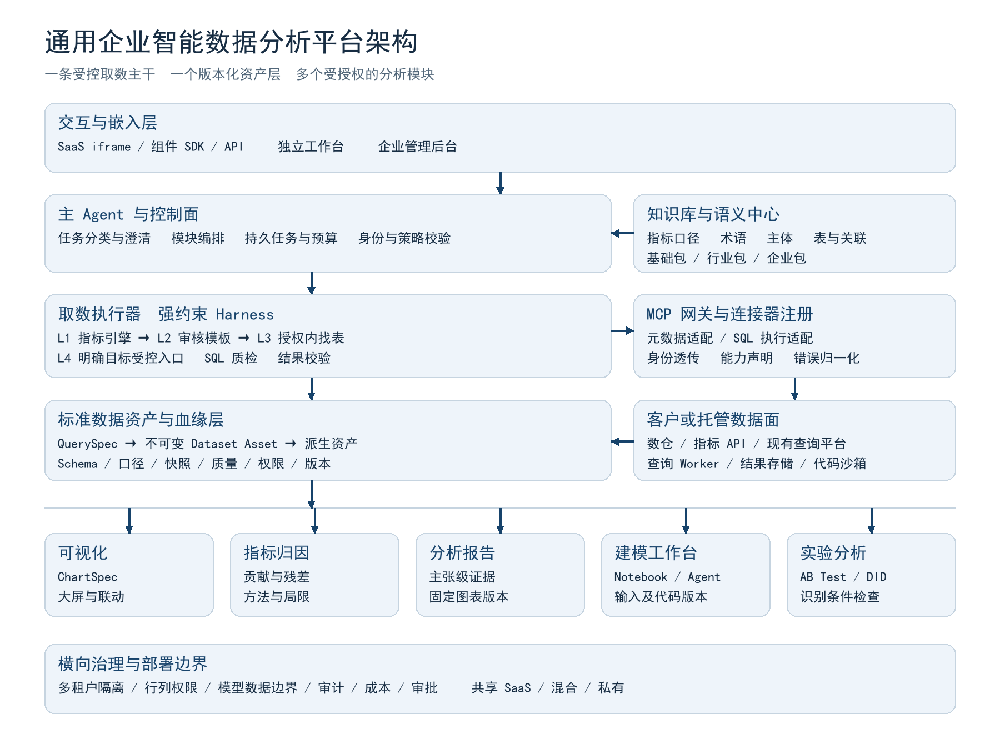
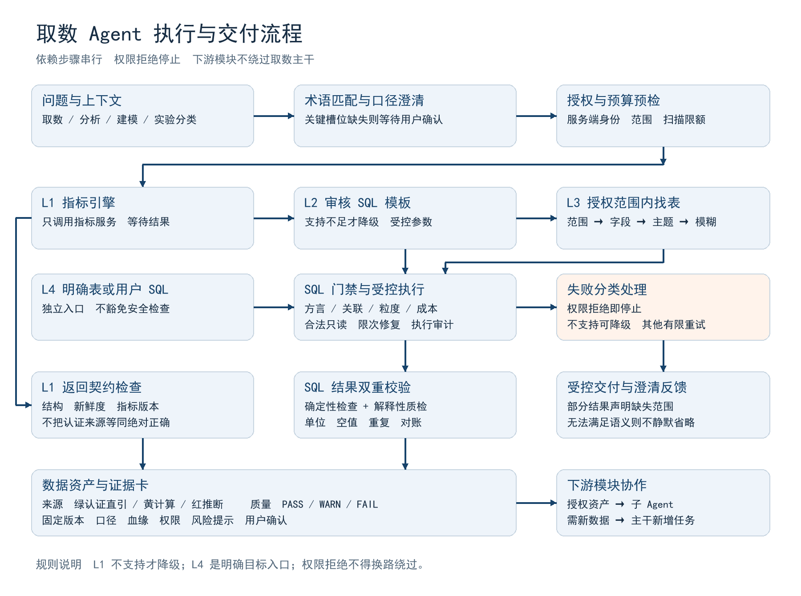

# 本项目实施路线补充（2026-10-27）

下方V0.1为历史策划、图/PDF和周数/成功率均不表示当前交付。用户现已批准模块PRD与顺序：M02收尾→M04-A模型API→M03语义知识库→M04-B LangGraph受控问数。M04-A独立薄适配/M04-B复用确定性安全门禁，原M04 ID保留。最新需求、证据和路线见project-control/prd/README.md、project-control/ROADMAP.md与progress.json；本轮不改PDF/历史图片或称其已同步为新版。

---

# 通用企业智能数据分析平台产品策划方案

版本 V0.1 ｜ 日期 2026年10月23日 ｜ 阶段 产品立项与方案评审

## 01 执行摘要

建议将本产品定位为可嵌入企业 SaaS 的智能数据工作台，而不是功能叠加式 NLP2SQL 工具。产品围绕一条可治理的取数主干构建：用标准化业务知识解释问题，用分层路由优先复用可信指标，用受控查询补齐覆盖范围，再把结果封装为可复用、可追溯、受权限约束的数据资产。可视化、归因、报告、建模与实验模块通过该资产协作。

产品的核心资产不是某一个大模型，而是四类可迁移能力：租户可配置的业务语义包、具备能力声明的连接器、可执行的 Agent Harness、贯穿查询与分析的证据链。建议采用共享控制面与可选私有数据面的部署设计，兼顾中小客户的 SaaS 接入与大型客户的数据不出域需求。

首期应验证三个问题：企业能否低成本完成语义接入；典型业务问题能否得到口径一致的结果；结果能否直接被大屏和报告复用。不要在首版同时开发完整 Notebook IDE、在线实验分流系统和全部数仓连接器。推荐先交付取数、知识库管理、两个标准连接器、基础可视化与证据化报告，再按客户验证逐步扩展。

本文给出产品边界、功能规格、架构、知识库标准模板、MCP 接入规范、跨模块数据契约、安全治理、技术栈建议及实施计划。预算、覆盖率和时程均为立项假设或建议验收目标，需要试点校准，不代表已经验证的交付承诺。

### 1.1 对现有构想的继承与调整

保留 data-query-routing-normal 的 L1 指标引擎、L2 专项 SQL、L3 数仓找表、L4 指定表字段和直给 SQL 路径；保留 sql-quality-check 与 python-quality-check；保留任务先分类、依赖步骤串行、口径不明先澄清、失败分类处理、三档来源标识等理念。

作三点产品化调整。第一，L4 定义为明确目标的受控入口，不是所有失败之后的无限兜底。第二，绿色来源标识仅表示直接引用已认证上游数据，不表示绝对正确或因果成立；黄色计算结果也可以具有高可信度。第三，图片中“90% 一次成”等描述不直接转为市场承诺，需要基于客户问题集测量。

## 02 产品定位与客户选择

### 2.1 目标客户

优先服务已经具备业务 SaaS、数据团队或可用数据仓库的企业，以及希望给现有 SaaS 增加智能分析能力的软件服务商。用户只拥有业务 SaaS 而没有可访问的分析数据库时，需要通过业务 API、客户已有同步系统或数仓建设完成数据准备；本产品不默认承担全量 ETL。

首批理想客户条件：存在明确的分析场景与业务负责人；能够授予最小只读查询权限；至少有一组可确认的核心指标；愿意提供历史问题与已确认答案作回归用例。完全没有指标口径、数据质量长期不稳定、仅支持高负载生产库直连的客户不宜作为首批标准化样板。

### 2.2 用户角色

| 角色 | 主要诉求 | 可执行操作 |
| --- | --- | --- |
| 业务使用者 | 自然语言问数和查看报告 | 在获授权范围提问、筛选、订阅与导出 |
| 分析师 | 明细分析和可复现计算 | 查看 SQL、创建派生资产、归因、建模与实验分析 |
| 数据治理人员 | 确认口径和管理知识 | 审核指标、维护实体及关联、批准知识版本 |
| 租户管理员 | 接入和安全管理 | 配置连接器、角色、限额、保留策略及审计 |
| SaaS 平台管理员 | 嵌入和租户运营 | 配置 SSO、租户映射、组件能力和品牌 |

### 2.3 价值主张与非目标

相较单一 NLP2SQL，产品提供查询前的语义契约、查询中的安全门禁、查询后的数据资产及证据化分析。相较传统 BI，产品允许自然语言驱动受控分析，且能复用企业已有指标系统与 BI 资产，不要求替换所有现有看板。

首期非目标：替代企业数据仓库或全量 ETL；保证任意问题自动得到正确 SQL；绕过现有权限；自动发布业务动作；构建完整通用研发 IDE；把相关性自动解释为因果；在客户未集成事件与分流系统时宣称具备在线实验能力。

### 2.4 主要产品指标

北极星指标建议采用“经用户确认且可复用的分析任务完成数”，而非 SQL 生成量。配套指标包括明确口径任务的正确完成率、每租户有效复用资产数、结果复用到下游模块的比例、知识覆盖率、接入工时、单次成功任务成本。重复点击、失败查询和无数据的机械返回不计作有效完成。

## 03 用户流程与典型场景

### 3.1 问数到大屏

业务用户提出“上周各区域订单转化率如何”。系统识别取数任务，匹配指标与实体，检查时间、时区、转化分母和区域归属；必要时显示结构化澄清卡。L1 返回受认证指标则直接生成数据资产；无法覆盖但可合法执行时进入 L2 或 L3。用户查看口径卡、数据表、来源标识与风险说明，点击“生成大屏”。可视化 Agent 消费 asset_id 与字段语义，而不是读取未经约束的聊天记录。

### 3.2 变化解释与报告

用户提出“为什么转化率下降”。系统创建分析任务，先核对两个可比窗口与指标版本，再申请所需切片数据。归因 Agent 分解区域、渠道、产品等因素，输出贡献表、残差与方法局限；报告 Agent 引用同一版本的归因结果和图表。没有实验或可信识别设计时，报告表述为“结构变化贡献”或“关联线索”，不表述为“某因素导致下降”。

### 3.3 上传文件与建模

分析师上传 CSV、Excel 或 Parquet；文件通过隔离解析、模式识别、敏感检查与质量检查后成为 UPLOADED_DATA 资产。用户可把取数资产和上传资产组合成工作区，选择手写代码或建模子 Agent 协助。代码在受资源和网络限制的容器执行，结果、依赖、代码版本和输入快照统一登记。

### 3.4 实验分析

实验负责人选择历史 AB Test 分析或准实验 DID。AB 路径检查分流单位、曝光记录、样本比例和指标窗口；DID 路径检查处理时点、面板覆盖与对照组。系统先输出数据与设计是否满足分析条件，再运行估计。识别条件不满足时，可以返回描述性结果与整改建议，不给出可推广的因果结论。

### 3.5 SaaS 内嵌

客户从自己的 SaaS 页面进入智能分析组件，经服务器侧 SSO 交换获得短期会话。平台从身份系统确定 tenant_id、user_id 与 scope，不能接受浏览器自行指定租户。组件保持当前产品、组织、时间范围等允许的上下文；结果只能在该租户和当前用户权限内访问。

## 04 产品功能结构与优先级

| 模块 | 核心输出 | 首版范围 | 后续范围 |
| --- | --- | --- | --- |
| 取数主干 | QuerySpec 与 Dataset Asset | 澄清、L1至L4、SQL门禁、查询及质量卡 | 多源分析、受控调度和高级成本优化 |
| 知识库与语义中心 | Domain Pack | 指标、术语、实体、表映射及审批 | 行业模板市场与版本迁移工具 |
| 连接器中心 | Capability Manifest | 两个标准连接器及一个客户适配接口 | 按试点需求扩展认证矩阵 |
| 可视化 | ChartSpec 与 Dashboard | 模板化交互看板、基本联动及导出 | 高自由度布局、主题与组件市场 |
| 归因 | AnalysisResult | 首版预留接口 | 结构分解、漏斗诊断和异常切片 |
| 报告 | ReportSpec 与文档 | 基础报告、数字及图表引用 | 归因联动、多模板与订阅 |
| 建模 | Notebook Run 与模型资产 | 首版预留接口 | Notebook、Agent写码与训练评估 |
| 实验 | ExperimentAnalysis | 首版预留接口 | 历史AB、DID及可选在线分流集成 |
| 管理与治理 | Policy 与 Audit | 租户、SSO、权限、限额及审计 | 企业审批、数据驻留与高级治理 |

“预留接口”仅交付 Schema、权限规则与事件类型，不应在首版包装为可用业务功能。完整性主要体现在统一协作底座，而不是所有模块同时上线。

## 05 总体架构与耦合方案



### 5.1 逻辑分层

交互层提供 SaaS 嵌入组件、独立工作台和管理后台。控制面负责身份、语义包、策略、任务编排、连接器注册和资产目录。数据面负责数仓访问、SQL 执行、结果存储与代码沙箱。上层模块共享资产和任务协议，但不共享数据库凭证。

对共享 SaaS 模式，数据面可由平台托管；对混合部署，控制面托管而查询及敏感结果保留在客户网络；对私有部署，整个平台在客户环境运行。选择私有数据面不自动保证数据不出域，还必须限制 LLM 请求、日志、向量索引、图表采样及错误栈中的数据外发。

### 5.2 主 Agent 与取数执行器

主 Agent 负责理解需求、选择模块、合并合法上下文与组织交付，不直接拥有无限工具。取数执行器是强约束状态机，负责澄清、路由、查询与结果校验。复杂分析通过分析任务发出数据需求，回到取数执行器新增查询，避免每个子 Agent 自行找表。

主 Agent 可以是同一模型承担的不同逻辑角色，也可以按成本及风险拆为模型实例；从产品上应把“角色”和“进程”解耦。路由、权限、预算和审批由确定性代码控制，模型负责计划建议、语义解释及受约束生成。

### 5.3 标准资产是模块连接点

取数完成后创建不可变版本的数据资产，asset_id 指向逻辑资产，asset_version 指向快照。数据本体进入对象存储或客户数据面的受保护位置，目录数据库保存 Schema、口径、血缘、质量与权限元数据。Agent 默认只获得资产描述和必要样本，不把完整大表塞进模型上下文。

ChartSpec、Dashboard、AnalysisResult、NotebookRun 和 ExperimentAnalysis 都登记为派生资产，通过 input_asset_versions 指向来源。报告引用图表和数字时固定版本；大屏刷新可更新“最新视图”，但不能静默修改已经发布的报告。

### 5.4 同步与异步

短时指标请求可以同步返回。长 SQL、批量图表生成和模型训练采用异步任务，返回 task_id，工作台展示状态并允许取消。重试需要幂等键；查询重试前先检查上游 query_id 是否已完成。取消任务要传播到执行平台并回收容器，不能只关闭页面。

建议状态为 CREATED、AWAITING_CLARIFICATION、AUTHORIZED、PLANNED、RUNNING、VALIDATING、SUCCEEDED、PARTIAL、FAILED、CANCELLED、EXPIRED。PARTIAL 是明确声明缺失范围的部分成功，不等于业务问题已完整解决。

## 06 取数 Agent 与 Harness 详细设计



### 6.1 任务先分类

区分取数、指标分析、体验洞察、建模、实验和普通对话。变化解释先检查取数需求而不是直接进入自由推理；体验洞察依赖 VOC 或文本数据的独立授权域。“某产品近六月情况”若既可能指经营指标又可能指客户反馈，先澄清目的。分类低置信或多意图时允许用户选择任务卡，不能把关键歧义作为已知业务事实。

### 6.2 四层路由

| 路径 | 适用情况 | 执行约束 | 输出要求 |
| --- | --- | --- | --- |
| L1 指标引擎 | 指标及所需维度已认证 | 单次调用后等待结果，不同时探测其他路径 | 上游指标版本、口径、时间及可用性 |
| L2 专项 SQL | 已沉淀主题与审核模板 | 受参数白名单与模板版本约束 | 模板ID、参数及SQL质检 |
| L3 数仓探索 | 缺少可用标准指标或模板 | 权限范围、允许字段、主题候选、模糊搜索逐步收敛 | 表选择证据、关联条件及粒度检查 |
| L4 明确目标 | 用户给出表、字段问题或SQL | 仍须授权、元数据核验、SQL门禁 | 字段解释或受控查询结果 |

L3 先获取有效授权范围及允许的元数据；可做缓存的粗粒度字段筛选，再查主题候选及其完整字段结构，最后才在同一授权范围内模糊搜索。无法获得可信授权范围时不能通过全库搜索代替。已明确目标的 L4 不要求先经历 L1 至 L3，但不得跳过安全和口径校验。

### 6.3 澄清机制

将图片中的固定反问推广为租户配置的槽位模板：时间范围、业务时间字段、指标版本、业务对象状态、组织或地理归属、币种、比较基准、过滤范围等。行业包可以增加库存口径、离店或入住或预订日期、取消处理等槽位；这些不是所有行业通用的八个必问项。

槽位分为必需、可默认、条件触发。已由上下文确定的槽位不重复反问；缺少关键槽位则不执行。默认项由租户治理人员批准，回答中列出采用的默认值。术语没有有效映射时不猜测，冲突口径显示来源、版本与责任人供确认。

### 6.4 SQL 安全及质量检查

执行前做静态检查：单语句只读策略、禁用 DDL/DML 和危险函数、参数化、标识符白名单、SQL 方言解析、跨租户过滤、粒度与关联检查、时间过滤和扫描预算。EXPLAIN 只用于合法可用的引擎能力；不支持时改用连接器估算及更严格限额。LIMIT 限制结果行数不等于限制扫描量，不能替代分区裁剪与成本门禁。

执行后做语义和结果检查：列名与类型、单位、时区、空值、唯一键、重复率、关联膨胀、合计守恒、异常范围、覆盖率、源表新鲜度及必要的已知答案对账。模型质检是解释性补充，不是程序检查的替代。所有平台生成的 SQL，包括审核模板和直给 SQL，都走门禁与相应质量检查；L1 无须重检不可见 SQL，但需要合同、新鲜度和返回结构校验。

### 6.5 Python 及其他代码检查

任何影响交付的代码均检查，包含图表派生计算、归因、建模和实验。要求显式输入版本、固定随机种子、依赖记录、异常处理、可重复运行和数据输出 Schema；运行时限制 CPU、内存、磁盘、时长及网络访问。禁止直接获得宿主机文件、长期令牌或跨租户目录。用户自行写码也不豁免沙箱和权限约束。

### 6.6 来源分档与质量维度

保留绿、黄、红三档作为来源类型：绿色 DIRECT_CERTIFIED 表示直接引用已认证上游结果；黄色 COMPUTED 表示执行 SQL 或做过计算；红色 INFERRED 表示没有充分数据证据的业务推断。不要用颜色表达统计显著性或自动计算的准确率。

另外提供质量状态 PASS、WARN、FAIL 和独立证据等级，例如可复现、已对账、仅描述性、具备特定因果识别条件。一个计算正确的同比可以是黄色且 PASS；一个新鲜度超时的认证指标可以是绿色且 WARN。混合报告按主张逐项标识，不用一张总颜色掩盖局部推断。红色内容不以已确认 KPI 的形式进入正式大屏。

### 6.7 失败与降级

权限拒绝立即停止同资源的相关路径，展示权限申请入口、被拒资源及不含敏感内容的错误说明。L1 上游接口权限拒绝时，不允许自动通过 L2/L3 取同一业务数据。其他资源只有在独立授权并经策略明确允许时才可重新计划，不以“换连接方式”绕过拒绝。

不支持该指标、维度或主题可以转向下层；超时或临时故障允许在预算内有限重试；SQL 语法错误只在相同权限和业务目标下有限修复。L3 无结果则声明未找到可用表，不编造表名。敏感字段受限时只提供策略允许的聚合或脱敏结果；若省略会改变问题语义，则要求重新确认而不是静默删列。

### 6.8 工具调用顺序与预算

存在依赖的路由、澄清、表选择和 SQL 验证串行执行。不同且已独立授权的表结构查询可以并行；子模块消费同一已完成快照也可以并行。每次任务限定最大工具调用数、修复次数、执行时间、扫描预算及模型费用，并保留 route_trace。超限进入显式失败或审批，不无限探索。

## 07 企业知识库标准模板

### 7.1 两类知识分离

机器执行依赖结构化语义记录，解释和补充检索使用文档知识。RAG 能找到业务说明，但不能直接把一段未审核文档提升为可执行指标或权限规则。指标引擎适配属于工具与结构化语义层；指标口径、术语和实体分类属于可版本化的知识层。

建议交付 Domain Pack 标准目录及 JSON Schema，让客户填配置而非改核心代码。产品内置导入向导、完整性检查、冲突检测、责任人审批、回归测试和版本发布。可以导入 YAML、JSON、CSV 及既有文档；若生成 Excel 导入模板，则每个工作表对应固定 Schema，不能依赖自由排版。

### 7.2 标准目录

```text
domain-pack/
  manifest.yaml              包ID、租户、版本、有效期与依赖
  metrics.yaml               指标定义、维度和引擎映射
  glossary.yaml              术语、别名、歧义与作用域
  entities.yaml              主体、分类、主键与时效
  mappings.yaml              逻辑对象到物理表字段
  joins.yaml                 允许关联、基数与粒度
  clarification.yaml         槽位、默认值与触发条件
  templates.yaml             审核SQL模板及参数契约
  policies.yaml              语义使用限制与外部策略引用
  quality-rules.yaml         质量、时效和对账规则
  examples.yaml              问题、期望QuerySpec和测试结果
  docs/                      业务说明及证据链接
```

### 7.3 指标定义模板

| 字段组 | 必填内容 | 校验及用途 |
| --- | --- | --- |
| 标识 | metric_id、名称、领域、版本、状态 | ID稳定、发布版本唯一、草稿不作为认证指标 |
| 数学口径 | 公式、分子分母、统计单位、空分母规则 | 禁止由模型临时猜测分母和单位 |
| 统计粒度 | 基础粒度、可分组维度、去重键 | 防止把用户级指标错误汇总成订单级 |
| 汇总语义 | additive、semi_additive或non_additive | 比率由分子分母重算，不默认平均百分比 |
| 时间 | 时间字段、时区、窗口、迟到数据规则 | 同比环比及刷新保持可比 |
| 范围 | 状态、取消、退款、过滤、币种 | 口径卡显示所有影响数值的限制 |
| 执行映射 | 引擎ID或审核模板ID、参数Schema | 绑定连接器能力，不写入明文凭证 |
| 治理 | owner、审核人、来源、有效期、变更说明 | 可追责、回滚和历史报告复现 |

### 7.4 术语与主体模板

术语记录必须包含 term_id、标准名、别名、领域、适用组织、映射对象、歧义说明、冲突优先级和有效期。“间夜”“活跃用户”“净收入”等词不可仅存同义词，还要指向明确的指标或实体版本。冲突优先级由治理人员配置，不由模型自行选一份文档。

主体分类记录必须包含 entity_id、主键、层级、可选多重归属、类型枚举、属性字段、组织边界与缓慢变化规则。客户、用户、账户、商户、门店、商品、订单、渠道、实验单元可作基础实体模板。区域归属必须说明使用交易时归属还是当前归属，避免历史分析在组织调整后被重写。

### 7.5 表映射与关联模板

每张表记录 datasource_id、全限定名、业务用途、数据层级、行粒度、主键、分区、更新时间、可访问字段、敏感等级和责任人。每条关联记录两端逻辑对象、关联键、1对1或1对多或多对多、时效条件、允许分析粒度及防膨胀方式。多对多默认不允许自动展开，需要桥表或明确聚合方案。

### 7.6 包的继承与发布

推荐基础包、行业包、企业包三层。行业包提供问题模板和待填字段，不替企业确认口径。企业包可以显式覆盖行业定义，覆盖必须有理由、影响分析和回归结果；用户临时选择不永久修改企业认证口径。依赖锁定具体版本，发布前检查引用完整性、执行可用性、权限兼容性及样例对账。

审批流为导入草稿、结构校验、业务确认、测试、审批、发布。变更指标公式、粒度或有效期属于破坏性变更，建立新版本并通知关联大屏和报告负责人；不得覆盖原快照。知识文档中的命令、网页提示或表字段注释均视为数据，不作为 Agent 指令或权限依据。

## 08 MCP 与数据平台连接器体系

### 8.1 接入原则

MCP 是工具交互协议，不保证不同数仓的权限模型、SQL 方言、执行能力和数据驻留完全一致。建议内部定义稳定的 Connector API，对外把兼容能力暴露为 MCP 工具。已有 MCP 服务通过适配器纳入治理；没有 MCP 的系统可通过官方 API、驱动或客户查询平台适配后统一暴露。

数仓与 SQL 运行平台应是两类可组合适配器：Metadata Provider 提供数据库表字段和血缘；Execution Provider 提供执行、状态、取消及下载。一个客户可以使用数仓元数据和现有 Adhoc 平台执行，二者通过 datasource_id 及显式映射关联，不能假设引擎同名就代表同一权限域。

### 8.2 标准工具契约

| 工具 | 输入要点 | 输出要点 |
| --- | --- | --- |
| get_capabilities | connector_id、身份作用域 | 能力、限制、版本及鉴权方式 |
| get_effective_scope | 服务器确定的主体与资源域 | 可访问资源范围或可信策略引用 |
| search_tables | 已授权scope、主题、关键词、页码 | 授权内候选及选择依据 |
| describe_table | 全限定表名与scope | 允许字段、类型、粒度和分区 |
| get_freshness | 表或指标及scope | 更新时间、分区与可信来源 |
| validate_or_explain | 已规范化SQL、预算、scope | 风险、估算成本或明确不支持 |
| submit_query | query_spec、参数、幂等键、预算 | query_id及状态 |
| get_query_status | query_id、当前scope | 状态、执行统计及错误类别 |
| fetch_result | query_id、分页或资产请求 | Schema、受控结果或资产引用 |
| cancel_query | query_id、主体 | 取消结果与回收状态 |

get_effective_scope 并非要求所有系统都能列出全部权限；可以返回外部策略引用与授权校验方法。无法可靠获得授权信息时，只开放明确已授权的资源，不启用探索模式。所有工具请求均在服务端重新鉴权，不能信任模型附带的 tenant_id 或 scope 字符串。

### 8.3 能力声明与认证

Capability Manifest 描述 supports_catalog、supports_column_acl、supports_row_policy、supports_explain、supports_async、supports_cancel、supports_download、supports_query_cost、supports_partition、sql_dialect、max_result_bytes、鉴权和部署模式。能力未知应为 unknown，不默认为 true。取消或扫描成本能力缺失时，使用更严格的时长、配额和客户查询平台限制，且在能力卡提示不足。

认证分层：候选连接器仅完成设计；基础连接器通过连通、只读查询与类型映射测试；治理连接器进一步通过身份透传、行列权限、预算、取消、审计及驻留测试。营销兼容清单必须与实际认证结果一致，不能把“存在社区 MCP”作为企业级兼容证明。

### 8.4 候选接入矩阵

| 类别 | 候选系统 | 建议路径 | 实施优先级 |
| --- | --- | --- | --- |
| 开源分析与SQL | PostgreSQL、Trino | 驱动或官方协议加统一适配 | MVP先选这两个作基准 |
| 国内常见数仓 | Hive、Spark、StarRocks、ClickHouse | 客户查询平台或适配器 | 依真实付费试点替换或扩展 |
| 云数据平台 | Snowflake、BigQuery、Databricks | 官方SQL与目录API适配 | 第二阶段按客户排序 |
| 云厂商仓库 | Redshift、Synapse、MaxCompute | 官方服务API或驱动 | 需求验证后扩展 |
| 现有SQL平台 | 企业Adhoc、Notebook及审批平台 | 封装submit status result流程 | 首期预留一个客户定制接口 |
| 指标和目录 | 客户指标API、dbt语义资产、数据目录 | 语义映射或只读元数据适配 | 优先复用而非重建 |

此表是研发候选清单，不是已接入声明。首期两个连接器可因目标行业调整，但必须保持一个标准驱动接口和一个异步平台接口的设计验证。

### 8.5 连接器安全与运维

令牌进入 Secret Manager 或客户本地凭证系统；Agent、聊天记录和前端不接收长期密钥。客户端 OAuth、服务账号加委托身份或客户网关代理均需明确安全边界。连接器实施最小权限、服务健康检查、速率限制、熔断、分页、重试和错误归一化。

统一错误类型包括 PERMISSION_DENIED、AUTH_EXPIRED、UNSUPPORTED_CAPABILITY、NOT_FOUND、INVALID_QUERY、BUDGET_EXCEEDED、TIMEOUT、SOURCE_UNAVAILABLE、SENSITIVE_BLOCKED。日志隐藏凭证和敏感 SQL 字面值；下载链接短期有效，取用时鉴权，不把上游返回的认证头暴露给业务用户。

## 09 跨模块数据及任务契约

### 9.1 QuerySpec

自然语言首先编译为 QuerySpec，记录 intent、metric_refs及版本、entity、dimensions、filters、time_range、time_field、timezone、grain、currency、comparison、required_scope和acceptance_checks。QuerySpec 是机器执行前的人机共识，可在界面确认；它不同于 SQL，能够映射到指标 API 或多个方言。

QuerySpec 的用户可编辑字段与服务器附加字段分离。tenant_id、principal、policy_context、实际预算和连接器权限由后端注入，不由用户、模型或上传文件自行决定。变更关键口径后必须生成新 QuerySpec 版本。

### 9.2 Dataset Asset

必需字段包括 asset_id、asset_version、tenant_id、schema_version、data_ref、content_hash、schema、row_count、grain、units、timezone、metric_contracts、provenance、quality、policy_ref、retention及created_at。provenance 记录 route、connector_version、query_id、SQL指纹、Domain Pack版本、代码版本和上游快照时间。

data_ref 是内部引用，不是永久公开下载 URL。外部输出按当前权限生成临时链接。结果超大时提供分页、Arrow 流或受保护对象存储；聚合摘要与完整结果区分，禁止把预览前50行当作全量样本用于归因或实验。

### 9.3 派生资产与权限继承

派生资产记录 input_asset_versions、operation、parameters、code_or_spec_ref、creator、quality_checks、result_ref及limitations。默认继承所有输入的权限交集与敏感等级，不能因为聚合、生成图或生成文档就自动公开；允许降敏或更宽共享必须由明确的治理策略批准。

撤销权限后，读取、导出、刷新和子 Agent 再运行都重新检查；已下载到客户外部环境的文件无法保证远程撤回，因此应限制导出、加水印并在合同和界面提示这一边界。到期资产停止使用，报告可以保留符合策略的摘要，但不能偷偷继续读取原明细。

### 9.4 任务与事件

建议事件采用 task.created、query.completed、asset.created、analysis.completed、dashboard.published、report.published及permission.revoked，并包含 event_id、tenant_id、resource_id、version、occurred_at、trace_id。事件只传引用和必要元数据，避免原始明细散播到消息总线。消费者按 event_id 去重，执行前检查资源授权和版本。

下游模块请求新的切片或明细时，提交 DataRequirement；取数主干判断是否可从已有快照安全派生，否则生成新的取数任务。上传数据与客户已批准的外部资产可以进入同一资产层，因此“以取数为主干”不等于禁止其他合法输入。

## 10 可视化与报告产品规格

### 10.1 大屏与可视化

输入为 Dataset Asset 和用户的展示目标；输出为声明式 ChartSpec、DashboardSpec和可审计的派生计算。首期建议 KPI 卡、趋势线、条形图、构成图和明细表，配合运营总览、渠道比较及漏斗分析模板。图表建议基于字段类型、粒度与业务语义，用户可调整样式。

大屏支持布局、筛选、时间控件、钻取、图表联动、版本发布及导出。刷新时按原 QuerySpec 重新执行，并检查指标和 Schema 是否变化；破坏性变化阻止刷新并提示负责人。每个组件可查看来源、更新时间、口径和质量告警。

高自由度通过受约束的组件 Schema、主题 Token 和插件实现，不默认执行 Agent 生成的任意 HTML/JavaScript。自定义组件先放入独立沙箱并审核网络、资源和输入输出协议，避免 XSS、越权和数据外传。

### 10.2 分析报告

报告生成过程分为证据整理、结构规划、文字撰写、数字校验、用户审阅和发布。每个定量主张通过 claim_id 关联 asset_version、指标字段、筛选条件、计算步骤与图表版本。报告 Agent 不重新抄算大屏数字；需要计算时创建可复现派生资产。

报告支持经营周报、专题分析、异常复盘及实验报告模板；核心内容包含目的、范围、口径、结果、证据、局限和建议。推荐首期支持网页报告与一种文档导出格式，后续按客户需要增加 PDF、Word、飞书等发布渠道。向外部工作区发送报告须有明确权限与用户确认，不因生成完成自动群发。

## 11 指标归因产品规格

### 11.1 归因类型

先支持可解释的结构分解：总量按维度分解，漏斗按阶段分解，乘积型指标按因素分解，比例指标基于分子分母或结构效应分解。选择算法需明确恒等式、分解顺序及交互分配方法，不能把任意指标统一套用“贡献百分比”。

对于较复杂组合可以提供顺序分解与 Shapley 型分摊的对比，但必须说明结果依赖模型和分摊规则。对预测模型的特征解释另标为模型解释，不与经营指标恒等分解或实验因果效应混淆。

### 11.2 输入与输出

输入需要基准与观察窗口、相同口径版本、允许分析维度、可比人群、粒度及质量要求。输出为变化总量、切片贡献、交互或残差、覆盖率、异常数据、方法及局限。贡献和必须能回到总变化，无法守恒则显示未解释项。小样本、缺失维度、组织重映射及数据延迟单独警告。

验收要求：同一输入可复现；贡献守恒在配置容差内；清楚区分绝对变化和百分点；不把观测性贡献写成因果证据；对选择过多切片造成的偶然异常提供校正或探索性提示。

## 12 建模工作台产品规格

### 12.1 功能边界

建设“面向分析任务的小型 IDE”，不是一开始复制完整 JupyterHub 或 VS Code。推荐成熟 Notebook 引擎承载执行，产品负责数据资产选取、上下文授权、代码建议、结果管理与工作流。Python 为首选语言，SQL 单元复用查询主干；R 等语言在有需求时增加。

首批功能为文件上传、数据预览、代码或Markdown单元、运行、停止、环境选择、Agent生成和修复代码、结果图表、文件导出及版本历史。建模 Agent 按用户确认的目标提出基线和候选方法，涉及重大业务假设或评估标准时要求确认。

### 12.2 可复现和评估

每次运行记录输入快照、代码提交、环境镜像、依赖锁、随机种子、参数、评估指标与资源用量。监督学习需明确划分训练、验证、测试集；时间序列优先时间切分；检查目标泄漏、样本不平衡和训练服务偏差。必须比较可用基线，不能只展示复杂模型最优的一次结果。

首期建模扩展交付离线训练和模型登记，不自动部署线上推断或写回生产数据。模型发布、定时推断及生产集成作为独立审批能力。上传 Excel 仅解析允许格式，不执行宏；压缩包限制解压体积与路径，文件解析和模型执行分开隔离。

## 13 实验平台产品规格

### 13.1 AB Test 分析

输入至少包含实验ID、分流或随机化单位、分组、分配及曝光时点、指标事件、实验窗口、排除规则和实验方案。方案在分析前记录主要指标、护栏指标、MDE、显著性阈值、功效和分析方法，避免事后挑选结果。

输出包含样本量、样本比例异常检查 SRM、基线与曝光一致性、效果估计、置信区间、统计检验、护栏和可推广范围。是否采用 ITT 或符合预定义条件的曝光分析须事先说明；用户级随机化应在相应单位上统计或聚类，不把事件数量当作独立样本量。

CUPED 等方差缩减仅在存在合适实验前变量时使用。多指标多次查看需要预先约定多重检验或序贯方案，不能在每天重复检验后把第一次显著当作最终成功。SRM、埋点不一致或污染严重时阻止正式结论。

### 13.2 DID 与准实验

输入包含处理组、对照组、单位ID、时间、处理时点、结果指标及必要协变量。至少检查处理前覆盖、平行趋势证据、预期效应、政策叠加、组间溢出与样本组成变化。平行趋势不是“检验不显著就证明成立”，需要可视证据、领域合理性和敏感性分析。

单一处理时点可从基础 DID 开始；分批实施政策需采用适合错位处理的估计设计，不能机械使用双向固定效应并忽略异质处理效应。输出效应、标准误或置信区间、事件研究、稳健性与识别局限。缺少有效对照或处理前数据时返回数据整改清单，可提供描述性比较但不宣称可信因果效应。

### 13.3 在线实验是独立集成范围

在线分流还需要分桶服务或接入已有特性开关、互斥层、实验注册、曝光SDK、事件管道和安全停止机制。建议先支持客户已有实验平台的历史分析；只有付费需求验证后再提供编排与分流适配，不把 AB 分析模块等同于在线实验平台。

## 14 多租户安全与治理

### 14.1 权限不提升原则

默认要求“子 Agent 有效权限不高于发起者和授权执行服务的交集”。基础采用 RBAC，数据资源加 ABAC 或客户策略系统映射；真正的行列限制优先在数据源、网关或受验证查询层实施。提示词、前端隐藏与向量检索过滤都不能单独作为安全边界。

共享服务账号仅在数据面能够可靠施加用户权限且经过安全验证时使用；否则使用身份透传或独立资源连接，避免把拥有全库权限的账号交给 Agent。跨租户、跨组织和导出权限分别检查。

### 14.2 模型与检索安全

业务文件、数据库注释、网页与知识文档都作为不可信内容处理。检索内容不得修改工具白名单、授权策略或系统指令；模型建议的新工具调用需要结构校验与服务端授权。启用租户域过滤和文档ACL，生成回答时再检查引用授权。

提供客户可选模型供应商和受审查的模型路由；敏感任务可以要求客户域内模型，或只传脱敏Schema和必要统计摘要。必须分别说明模型服务的数据处理条款、日志保留、区域和调用边界，不能仅写“私有部署即合规”。

### 14.3 缓存、存储与审计

缓存键包含 tenant_id、有效权限指纹、指标版本、查询规范、数据快照或新鲜度边界；检索索引、对象路径和执行容器均隔离。权限撤销令缓存失效。资产访问和链接生成使用当前权限，而不是创建时的一次验证。

审计记录问题摘要、澄清、路由、知识版本、授权决策、工具调用、SQL指纹、运行统计、质量检查、资产及导出。避免记录完整敏感明细和密钥。提供删除、保留期限、备份、恢复和审计导出策略；客户数据与调试数据有不同保留规则。

## 15 推荐技术栈与实现策略

| 层次 | 首选建议 | 选择理由与替代边界 |
| --- | --- | --- |
| 前端 | React、TypeScript、Next.js | 支持工作台和嵌入SDK；简单嵌入可用独立组件包 |
| 图表 | ECharts加受约束ChartSpec | 自定义布局和企业大屏；Vega-Lite适合声明式分析图 |
| 后端 | Python、FastAPI、Pydantic | 靠近SQL分析和建模生态；接口Schema统一校验 |
| 编排 | 确定性状态机加持久任务队列 | 首期降低复杂度；必要时LangGraph辅助模型状态 |
| 长流程 | 第二阶段考虑Temporal | 审批、恢复、取消、幂等；不要求MVP即引入 |
| 元数据 | PostgreSQL | 存资产目录、租户和语义包；不能只用向量库 |
| 检索 | PostgreSQL全文检索及可选pgvector | 先结构检索后RAG；数据量和质量验证后扩展 |
| 查询治理 | SQLGlot加方言适配器 | AST检查和部分转换；不假设任意方言可自动互转 |
| 数据传递 | Arrow、Parquet、S3兼容对象存储 | 降低大表复制；混合部署可保留客户域内 |
| 代码执行 | 隔离容器加Notebook执行内核 | MVP用成熟组件；高风险多租户考虑更强隔离 |
| 模型运行 | 环境锁定与可选MLflow | 建模阶段引入，不让首版为完整MLOps买单 |
| 身份与密钥 | OIDC/SAML对接、Secret Manager | 复用客户身份；策略可对接OPA或现有授权服务 |
| 可观测性 | OpenTelemetry与任务审计 | 追踪模型、工具和数据链路；业务数据脱敏 |

### 15.1 不建议过早微服务化

首期采用模块化单体加独立执行 Worker：控制面共享代码库，按语义、连接器、任务、资产、可视化和报告划清模块边界；查询 Worker、文件解析 Worker、代码沙箱因风险和资源独立运行。达到租户规模、团队边界或隔离需求后再拆服务。

不要同时引入多套 Agent 框架、多个消息队列和多个向量库。优先用稳定 Schema、状态机、测试集和安全边界实现可替换性；大模型供应商通过统一接口路由，但不同模型的工具能力仍需独立评测。

### 15.2 开放扩展接口

Module Manifest 声明模块ID、版本、输入资产类型、输出Schema、允许工具、资源限额、网络需求和UI入口。插件默认无数仓凭证，仅可请求授权资产和主干取数。第三方插件经签名、依赖审查和安全测试后上架；核心租户权限和资产审计不允许插件覆盖。

## 16 SaaS 接入与标准化交付

### 16.1 接入方式

提供三种方式：iframe 快速接入、React或Web Component SDK深度嵌入、纯API供客户自建UI。iframe 采用明确来源限制与 postMessage 契约；SDK 采用短期会话和受控scope；API支持任务创建、状态、结果、资产及报告引用。服务器间认证与浏览器会话分离。

SaaS 宿主需提供用户身份、租户映射、组织边界、品牌、场景入口和可选业务上下文；本平台提供语义向导、连接器管理、资产和模块。租户配置的可变项包括语言、时区、币种、指标包、连接器、默认槽位、限额和主题；安全底线不得由普通配置关闭。

### 16.2 接入流程与验收产物

| 阶段 | 客户输入 | 平台交付 | 阻断条件 |
| --- | --- | --- | --- |
| 资格检查 | 架构、场景、数据准备和负责人 | 接入范围及责任边界 | 无合法数据源或无业务责任人 |
| 身份接入 | SSO与租户组织映射 | 登录和隔离测试 | 用户scope无法可靠映射 |
| 数据接入 | 只读资源和执行路径 | 连接器能力卡及测试报告 | 权限或驻留要求不满足 |
| 语义接入 | 10至20个优先指标与实体 | 企业Domain Pack草稿 | 关键口径无人确认 |
| 回归验证 | 30至50条确认过的问题 | 口径、SQL、数字及安全测试 | 核心问题对账或隔离失败 |
| 灰度发布 | 小范围业务用户 | 模块模板、培训与运行看板 | 成本或成功率未达门槛 |

建议先用较少核心指标和问题形成闭环，而不是一开始导入全公司所有表。若数据准备、权限及业务审核已完成，目标是用五至十个工作日完成标准试点配置；这不包含客户安全审批、网络打通、历史数据整改及定制适配开发。

### 16.3 模板化的真正边界

高度模板化意味着字段、契约、流程和测试可复用，而不是任何公司只填一个数据库地址就能正确问数。实施成本集中在指标口径、身份映射、数据粒度和客户执行平台适配。应将这些工作显式定价和估时，不靠后续人工维护掩盖接入成本。

## 17 验收体系与评测

### 17.1 离线任务集

每租户建立确认过的问题集，包含直接指标、模板SQL、探索SQL、字段说明、歧义问题、权限拒绝、超时、空数据、敏感限制和下游复用。每条记录问题、上下文、预期QuerySpec、允许路由、已确认答案、容差和期望风险提示。SQL字符串不同不等于结果错误；需比较语义、粒度、单位与最终数字。

统计分母必须明确：全量任务正确完成率、可回答任务正确完成率、歧义任务澄清率和不可回答任务正确拒绝率分别统计。不能剔除失败问题后宣传成功率。评测固定模型、语义包、连接器和数据版本，覆盖升级前后回归。

### 17.2 建议首期验收目标

| 项目 | 建议目标 | 说明 |
| --- | --- | --- |
| 认证指标准确性 | 所选关键指标全部在约定容差内对账 | 试点金标准由客户确认 |
| 可回答任务正确完成率 | 目标不低于90% | 仅为待验证目标，须报告完整任务分母 |
| 关键口径歧义 | 未确认前不执行 | 已批准默认值例外且明确显示 |
| 越权与跨租户测试 | 测试集中零成功越权 | 是发布门禁，不是风险绝对为零的证明 |
| 数据资产血缘 | 所有已发布结果均有版本及来源 | 预览及失败任务不冒充正式资产 |
| 安全门禁 | 所有代码及查询走受控执行 | 不能通过插件或直给SQL绕过 |
| 认证指标响应 | 建议p95在15秒内 | 明确负载和缓存条件，需压测校准 |
| 长任务 | 可追踪、可恢复和有限取消 | 上游不支持取消时显式标注 |
| 报告数字 | 所有关键数字有证据引用 | 自动校验加人工抽查 |

### 17.3 运行监控

按租户和场景监控成功、澄清、降级、拒绝、重试、质量告警、上游延迟、扫描量和单位任务成本。连接器或指标出现集中失败时暂停相关能力并提示，不让 Agent 无限制转向更昂贵的探索。升级模型先跑影子任务与回归，再灰度切换。

## 18 商业模式与成本

### 18.1 产品分层

建议基础版提供取数、知识库、标准连接器、基础大屏及报告；专业分析版增加归因、建模和实验分析；企业版增加私有数据面、高级SSO、细粒度治理、审计及定制连接器。SaaS 服务商可采用 OEM 或嵌入授权，按激活租户和用量计费，避免单纯按席位无法覆盖机器查询成本。

建议收费组合为平台订阅、用量配额和明确的接入服务费。连接器开发、行业包定制与私有部署独立报价。初期不提供无限制模型调用、无限扫描和无限Notebook运行；超配额提供预算提醒与审批。

### 18.2 单位经济模型

单任务成本应至少计入模型输入输出、数仓扫描与执行、沙箱时长、存储、数据传输和失败重试。客户自行承担的云仓费用也需单独显示，避免平台账单便宜但客户数仓账单暴涨。降低成本优先靠 L1 复用、已审核模板、资产复用和权限感知缓存，而不是牺牲质量检查。

定价需要以试点的单位成功任务成本、客户愿付价格和运维成本验证。本文不提供未经客户和负载验证的固定价格或市场份额预测。

## 19 实施路线图与团队建议

### 19.1 分阶段计划

| 阶段 | 建议时长 | 主要交付 | 进入下一阶段的门槛 |
| --- | --- | --- | --- |
| P0 产品与合同验证 | 2至3周 | 场景范围、数据契约、连接器PoC、问题集 | 客户责任人和金标准可用 |
| P1 MVP | 8至10周 | 主干、知识库、两个连接器、资产、基础大屏及报告 | 正确性、隔离和成本门禁通过 |
| P2 分析增强 | 6至8周 | 归因、Notebook、模块SDK及报告联动 | 数据复用和真实用户留存得到验证 |
| P3 实验与企业化 | 8至12周 | 历史AB、DID、私有数据面及治理增强 | 识别质量和部署安全评审通过 |
| P4 生态扩展 | 持续迭代 | 行业包、更多连接器和可选在线实验集成 | 以付费需求和认证能力推动 |

各阶段时长为顺序推进的粗估，合计约24至33周，不含客户审批等待及严重数据整改；阶段可重叠但不能跳过验收。若团队不足或只有单人开发，应进一步收缩首期至一个行业、一个查询平台、一个指标包和一种报告模板。

### 19.2 团队与职责

建议核心团队五至七人覆盖产品与业务语义、前端、后端与数据连接、Agent工程、分析算法、测试和平台安全；部分职责可以合并，安全、设计及统计方法可由兼职专家评审。客户侧至少需要业务口径负责人、数据资源负责人及身份安全负责人。

立项后的第一份PRD只聚焦取数主干与资产合同，其后分别写知识库管理、连接器、可视化和报告PRD。方法复杂的归因与实验模块另设统计设计评审，不仅做前端功能验收。

## 20 关键风险与决策清单

| 风险 | 影响 | 缓解策略 |
| --- | --- | --- |
| 全功能首期上线 | 周期长且主干未验证 | 按资产闭环分阶段交付 |
| 语义包只存文档 | 口径仍靠模型猜测 | 结构Schema与审核发布分离 |
| MCP兼容性被夸大 | 接入失败及安全责任不清 | 能力声明和连接器分层认证 |
| 子Agent自行取数 | 权限与口径漂移 | 统一DataRequirement回主干 |
| 缓存或导出泄露 | 跨租户与敏感数据风险 | 权限指纹、读取时再鉴权和导出控制 |
| 大屏报告数字不同 | 业务不信任结果 | 固定资产及图表版本，逐主张引用 |
| 归因误称因果 | 错误经营决策 | 方法分类和因果资格门禁 |
| 自由代码及插件 | 外传、资源耗尽和供应链风险 | 沙箱、能力白名单和签名审核 |
| 客户数据基础不足 | 接入周期不可控 | 资格检查与明确数据准备责任 |
| LLM与云仓成本失控 | 毛利和体验下降 | 单任务预算、配额、复用和熔断 |

### 20.1 建议本轮确认的产品决策

一是选择首个垂直场景，例如SaaS经营分析、零售运营或酒店经营，而不是同时覆盖所有行业。二是确定首批客户是企业直用还是 SaaS 服务商 OEM，这会影响身份、计费与嵌入优先级。三是确定首期部署接受程度及客户数据是否允许进入第三方模型。四是确认优先执行平台及十至二十个核心指标。五是确认首期报告渠道和大屏模板。

上述决策不影响先建立通用底座，但会显著改变连接器、业务包和演示场景。建议先验证一个“用户提问、确认口径、取得资产、生成大屏、形成报告”的可交付闭环，再扩展方法和行业。

## 附录 A 关键接口示例

以下示例为协议设计样例，指标名、ID和路径不对应任何已接入客户或已运行结果。客户端提交业务QuerySpec，服务器注入身份与政策。

```json
{
  "intent": "fetch_metric",
  "metric_refs": [{"id": "order_conversion_rate", "version": "1.0.0"}],
  "dimensions": ["region"],
  "time_range": {"start": "2026-10-12", "end_exclusive": "2026-10-19"},
  "timezone": "Asia/Shanghai",
  "grain": "region_week",
  "filters": [],
  "output": {"kind": "dataset_asset"}
}
```

Dataset Asset中业务语义和数据本体分离，下面省略部分治理字段，仅展示协作方式。

```json
{
  "schema_version": "1.0",
  "asset_id": "asset_example",
  "asset_version": "v1",
  "tenant_id": "server_injected",
  "data_ref": "protected://tenant/asset_example/v1/data.parquet",
  "schema": [{"name": "region", "type": "string"},
             {"name": "conversion_rate", "type": "decimal", "unit": "ratio"}],
  "grain": "region_week",
  "provenance": {"source_class": "COMPUTED", "query_id": "query_example",
                 "domain_pack_version": "1.0.0", "input_snapshots": []},
  "quality": {"status": "WARN", "checks": [], "limitations": ["example_only"]},
  "policy_ref": "policy_example",
  "retention": {"mode": "tenant_policy"}
}
```

Module Task声明允许的输入和输出，不给子Agent额外数据库权限。

```json
{
  "module": "visualization",
  "input_asset_versions": [{"asset_id": "asset_example", "version": "v1"}],
  "requested_output": "dashboard_spec",
  "allowed_tools": ["read_authorized_asset", "create_chart_spec"],
  "budget_profile": "interactive_standard",
  "publication": "requires_user_approval"
}
```

## 附录 B 首次评审与下一步产物

建议本方案评审通过后形成六份工程产物：MVP范围及验收PRD；QuerySpec与Dataset Asset的JSON Schema；Domain Pack导入及发布规范；连接器SDK与认证用例；取数Harness状态图与错误矩阵；一个包含约三十至五十条题目的试点评测集。

同步选择一个真实客户进行短期PoC：先人工确认金标准，用现有只读接口贯通取数与资产，再验证大屏和报告复用。PoC可以使用简化UI，但必须具备权限隔离、真实口径和可追溯来源；不要用伪数据效果图代替数据链路验收。

随文模板为接入包起点，保留待确认字段，不可直接作为生产认证定义。发布前仍需完整Schema验证、业务审批、连接器验证与真实对账。

