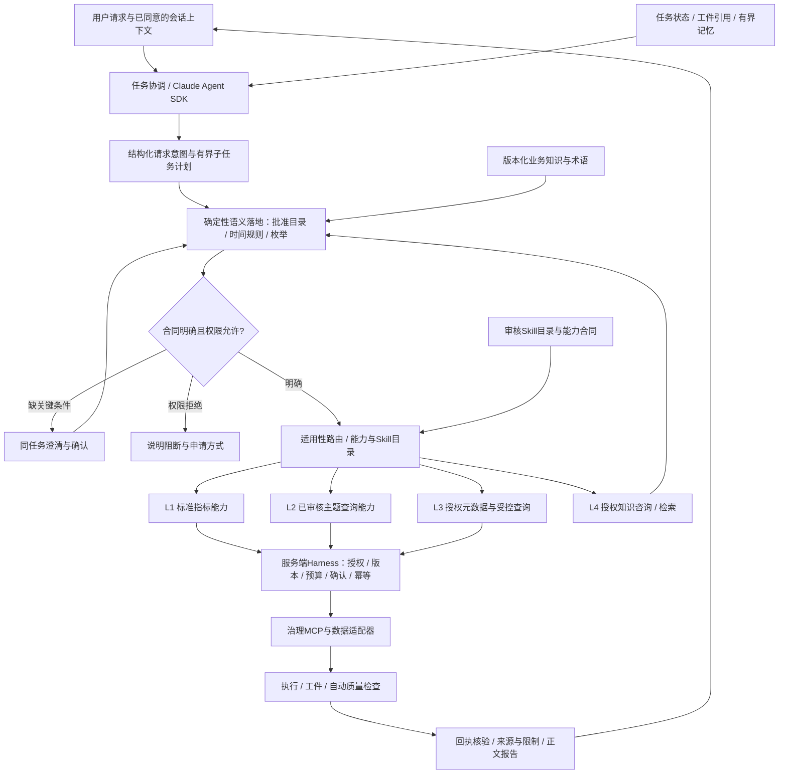

> **当前产品约束（2026-11-06，D086）：自然语言首问，无预选口径/来源；Agent探索与澄清后自主选源，右栏只投影实际来源/任务附件/产物。聊天附件与统一临时表、RAG兼容端口为规划，尚未实现。详见 `project-control/modules/M04/QUESTION_FIRST_ATTACHMENTS_PLAN.md`。旧手选来源要求已被覆盖，不删除历史验收证据。

# 通用受治理数据 Agent 架构 V2
2026-11-05 · D-ARCHITECTURE-GENERALIZATION-080 · 行业无关规划，不是新增实现证据

## 1. 定位与不变项
对话式数据助手补充已存在的固定报表，重点是自然语言长尾问题、口径核对和可追溯结果；不承诺即时响应、通用正确率、自动因果或替代专业分析。主交互保持连续对话、真实工具进度、可恢复澄清、正文报告与内嵌数据证据；技术信息渐进披露。

D070 Claude Agent SDK + 产品 Skills + 服务端治理 Harness 主线不变。模型可动态理解/选择工具，服务端只强制授权、关键业务合同、资源与结果门禁；不将全部推理写死为审批图。M01/M02/M04-A/M03已验收有限范围不重置，M04保持原ID；后续阶段和真实门禁不跳过。

## 2. 分层与职责
| 层 | 职责 | 当前或目标 |
|---|---|---|
| 交互与入口 | 会话UI、真实事件、确认/恢复；其他渠道通过统一授权接口适配 | Web已实现；其他渠道后续另批 |
| 任务协调 | 识别取数/解释/分析任务，维护子任务依赖与工件引用 | SDK单任务已实现；复杂任务协调拟增 |
| 语义解析与落地 | 请求结构、时间意图、候选目录、枚举匹配、必要澄清 | 结构语义/字段筛选已有；通用解析拟增 |
| 能力路由 | 适用范围筛选、能力描述检索、版本化Skill按需加载 | L1与有限L2/metadata已有；完整目录拟增 |
| 治理执行 | 身份/角色/数据/工具授权、只读SQL、预算/确认/幂等 | 当前开发范围已实现部分；企业身份未验 |
| 质量与发布 | 执行回执、质量检查、口径/版本/结果合同、来源/限制 | 自动QA/receipt发布已有；多工件报告后续 |
| 状态与知识 | 任务状态、对话上下文、偏好、业务知识、查询资产各自隔离 | 当前内存任务/非秘密语义；持久与RAG拟增 |

图展示目标职责；节点存在不代表当前全部实现。

## 3. 结构化请求与确定性落地
拟RequestIntent包含任务类型、主题候选、原子指标候选、口径修饰、时间意图、分组、筛选、排序/limit、比较关系、未决槽位及来源。不得让模型直接生成任意权限或数据库路径。

时间提取只产生结构化意图；由TemporalResolver以显式reference_now/timezone/calendar_version/data_cutoff解析日期与半开区间。缺时区/日历或相对日期有歧义则澄清，不能默认地域、工作日、周界或周期末。公开常识只能作候选，不修改批准的维度、枚举、目录或口径。

候选召回按授权主题/指标目录缩小范围，结构化过滤/词法检索先行；向量检索或分类模型只在确有增益、版本/许可/部署/费用获批后引入。枚举匹配必须指向批准目录值并携带证据；同义词、相似度、few-shot仅建议，不认证正确。低置信、多候选/关键缺省走澄清。

复杂请求只在依赖或多结果确需时拆解：TaskPlan记录节点输入/输出/依赖、维度/粒度/单位、比较期间、合并公式和检查。可由模型提出依赖，但服务端验证无循环、数量/预算有界及每步授权。单次group-by可解则不拆；比例/比较结果检查分母、零值、时间覆盖、可加性和单位，不能把简单平均当加权指标。独立子任务只在授权和资源允许时并行，不默认生成多个Agent进程。

## 4. L1-L4路由：优先级不是盲目逐层尝试
- L1优先使用适用的已发布标准指标；L2是审核主题能力；L3在无适用前两层且授权合同足够时探索真实元数据/受控查询；L4解决知识/口径问题或明确咨询请求。
- 首先检查能力是否适用。明确用户目标可跳过不适用能力，但必须有RouteDecision说明能力、理由、版本/口径/资源范围，所有危险动作仍过Harness；不添加新的层级编号以混淆现有合同。
- 分析路线与取数路线独立：基于已授权资产选择描述/分解/估计能力，检查方法条件；贡献、相关性、机制假设与因果识别分开，复杂统计仍需模块级审批。
- 失败分型：不支持/无匹配可重新选适用能力；可恢复传输/只读探测错误只能在预算内且确定不会重复执行时有限重试；权限拒绝立即停止；未确认执行结果UNKNOWN只读查回执，不另key/另引擎重提；QA失败保留证据、解释整改，不能用降级洗成成功。

## 5. 工具、Skill与执行隔离
CapabilityManifest拟包含输入输出Schema、适用任务/数据方言、权限/工具白名单、资源预算、产物与检查、取消/幂等能力。业务模板、解析器、数据适配器和分析方法各有职责，不让编排框架吞掉业务规则。

Skill目录区分人工审核/实验候选/自动生成待审状态（不与L1-L4路由级别共用编号）；description召回后才读取正文。执行工具要求批准版本、路由记录与授权；实验或生成Skill不能自动执行/升级权限。引入新索引/存储/模型或子Agent只按独立批准，不机械增加数据库/框架。

数据结果作为权限受限工件留后台；模型只获得按用途最小必要的合同与摘要，默认不外发完整结果行/会话历史。工具返回属于不可信输入，不能变成指令/权限。原始思维链不展示；公开模型意图、治理事实、质量状态各有来源。

## 6. 记忆、知识、状态、缓存、资产五分离
| 对象 | 应保存内容 | 禁止替代 |
|---|---|---|
| 任务状态 | 阶段、确认、工具回执、版本、工件引用 | 非生产认证或exactly-once保证 |
| 短期会话上下文 | 用户本次已确认范围、显式追问和必要最小摘要 | 不默认发送全历史或旧数据 |
| 长期用户偏好 | 仅用户明确要求记住、可查看/修改/删除的偏好 | 不存新业务口径或跨用户共享Skill |
| 业务知识/语义 | 术语、批准指标、目录、文档版本/引用/权限 | 不由偏好覆盖数据定义/授权 |
| 数据缓存/资产 | 查询结果与固定版本数据工件及保留策略 | 不让聊天记忆当数据事实真源 |

拟ContextEnvelope携带owner/conversation/task、source/semantic/model版本、purpose/consent、允许字段、token预算和引用。换身份/来源/模型/语义/Schema或权限撤回时检查上下文失效。长期记忆需要独立保留/同意设计，在M05之前不宣称生产持久化；存储选型复用已批准方向，向量库不是默认必要组件。

## 7. 可信输出不是单一交通灯
发布结果至少分开标：来源类型、执行状态、数据质量状态、业务口径审核状态、分析方法证据及限制；指标路径或来自文档不自动绿色认证，SQL检查通过不证明业务正确，统计模型也不自动因果。

PASS/WARN/FAIL/UNKNOWN各有独立行为；FAIL/UNKNOWN不能给已验证成功，WARN明确影响范围，空/部分结果说明覆盖。公开正文包含已确认口径、权威数值/表格、来源、检查覆盖、限制和下一步；来源颜色只是辅助，不以颜色隐藏缺失证据。所有准确率/延迟/收益须在实际授权评测下测量，不继承参考材料或示例百分比。

## 8. 当前差距与实施顺序（不重置模块）
现状：M04本机669后端/23前端/45浏览器/types/build/pip通过（历史实现证据）；L1、有限单表派生L2与metadata、同任务澄清/QA/公开说明已实现。V2为规划，不能据此改测试通过/验收状态。

1. **M04-S1 请求与上下文合同**：先做RequestIntent/ContextEnvelope/TaskPlan有界Schema与无数据行的合成金标准，版本/owner/同意失效检查，保持现有API兼容。
2. **M04-S2 时间与槽位落地**：确定性日期/日历、目录与枚举证据、分组筛选排序合同；解析Schema与行为先离线验证，再模型/预算授权实测。
3. **M04-S3 能力适用性与Skill目录**：versioned manifest、description→正文检索、L1-L4 route reasons/失败矩阵；不自动训练新模型或扩大执行工具。
4. **M04-S4 复杂任务与结果合并**：有界子任务依赖/工件权限/比较比例金标准/QA；不默认多Agent、多表或因果能力。
5. **M03-B 业务知识检索**：在原结构语义验收不重置前提下做明确新增切片，文档权限/版本/引用；嵌入费用或解析依赖另核。
6. **M05/M06/M07/M08**：正式持久状态与资产/记忆保留→可视化→证据报告→MVP端到端验收。M09-M12统计/企业部署按原门禁后续。

未批准：新部署/模型/公司数据、额外存储服务、真实费用、生产身份、任意SQL/JOIN/Python沙箱。文档调整不授予这些权限。

## 9. 信息保护与公开边界
本文件为重新表达的通用职责和工程合同，不包含原始材料、内部业务例子、指标/字段/码值、内部系统名、地址或水印身份。机密材料不得进入本项目工作树、公开Git/测试fixture/Skill/RAG或外部模型调用；单独私有归档。

脱敏不等于知识产权许可、权利转移或不可逆匿名性证明。当前V2衍生规划保留本地，公开发布前须权利人另行确认可公开范围；本轮不自动推送主项目的新衍生文档。私有仓库也不等于企业合规/加密/仅公司授权访问，只按用户本次限定归档授权操作。

## 2026-11-05 D081限定发布授权
用户明确批准本次脱敏通用架构、PRD、规划Skill及项目交接进度同步既有GitHub主项目。授权仅此通用规划集合；保密原始资料/PDF/逐页摘要/内部业务细节与私有定位不在公开范围。后续新增来源或衍生材料仍须复核可公开范围，不将本次批准推导为数据/模型费用/安装/执行权限/部署或模块验收。
